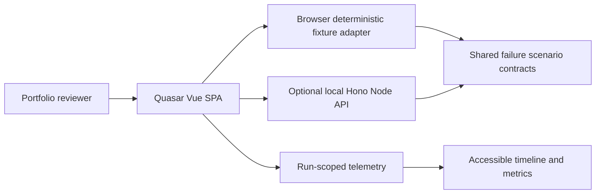

# System context (planned implementation)

The public Pages site does not require Local. See [`docs/implementation/01-architecture-and-layout.md`](../implementation/01-architecture-and-layout.md) for the proposed dependency DAG. This diagram is architectural intent, not a claim of implemented code.
