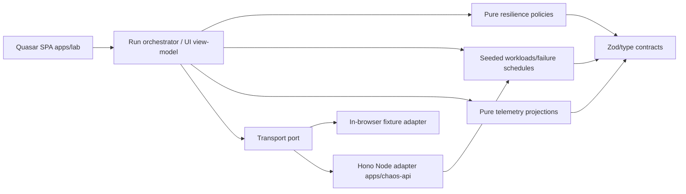

# Architecture, repo map and ownership

## Runtime diagram



## Proposed exact workspace roots

```text
apps/
  lab/                         # Quasar CLI app: src/boot, css, router, layouts, pages, modules
  chaos-api/                   # Hono Node runtime; no product logic duplicated
packages/
  contracts/                   # Versioned Zod schema + branded ids + public types
  resilience-core/             # Policy state machines, Clock/Random/Transport ports
  failure-scenarios/           # pure seeded workload + fault plan builder + fixture evaluator
  telemetry/                   # events, aggregation, projections, histogram/percentiles
specs/                         # checked-in golden scenario input, schema and expected rules
scripts/                       # seed, reset, verify, architecture imports, build integrity
tests/
  integration/                 # adapter parity and policy composition
  e2e/                         # Playwright reviewer-visible journeys
  contract/                    # shared port/API contracts if cross-package
.github/workflows/            # CI + Pages release, when implemented
```

### Allowed dependency graph

- `contracts` → nothing internal (Zod permitted); **never** Vue/Hono/Quasar.
- `failure-scenarios` → `contracts`; pure PRNG and clock-based simulation.
- `resilience-core` → `contracts`; pure policies, ports, no Hono, no Quasar, no telemetry implementation.
- `telemetry` → `contracts`; pure reducer, no UI dependencies.
- `apps/lab` → packages above + Quasar and browser-only adapters.
- `apps/chaos-api` → `contracts`, `failure-scenarios` + Hono and Node adapter.
- No package imports app, no domain package imports framework code, no cross-package deep imports, no circular dependency.

### Responsibilities and boundaries

- **Contracts:** Schema for scenario/workload/operation, result/outcome, trace/event, exported run, policy config, IDs. Strictly validate all parsed HTTP and imported JSON.
- **Failure-scenarios:** pure mapping `(seed, workload, logical operation, attempt, profile) → fault`; never randomize from wall time or module-global state. Failure classes include latency, timeout, HTTP status, disconnect, bad payload.
- **Resilience-core:** time budgets, retry/backoff, breaker state, concurrency permit, token bucket, fallback guards. Policy wrappers return typed result/rejection with telemetry hooks and propagate AbortSignal.
- **Telemetry:** append-only bounded trace (run-scoped), finite numeric projections, attempt vs operation counters, p95, queue/freshness, CSV/JSON export. Derive charts from event stream; do not maintain contradictory counters.
- **Quasar app:** scenario inputs, baseline/protected view models, transport choice, UX labels, routing, persisted run snapshots. No policy invariants inside Pinia or components.
- **Hono:** same deterministic fault evaluator and contract schemas as fixture. Health, request boundary validation, size/time caps, explicit allowed localhost origin. No default network access from public fixture.

### Ports (TypeScript signatures are illustrative proposals)

```ts
export interface Clock {
  now(): number; // monotonic run-relative ms, not Date.now() for tests
  sleep(delayMs: number, signal?: AbortSignal): Promise<void>;
}
export interface RandomSource { next(): number } // range [0, 1)
export interface Transport {
  execute(input: AttemptRequest, signal: AbortSignal): Promise<AttemptResponse>;
}
export interface TelemetrySink { emit(event: TraceEvent): void }
```

Keep `AttemptRequest`, `AttemptResponse`, `TraceEvent` in contracts, not copies. Avoid creating a single giant global service. Any new package needs an ADR and contract tests.

## Execution lifecycle

1. Parse versioned scenario config, reject invalid inputs.
2. Seed deterministic plan; create one **immutable experiment input** for both sides.
3. For each side, create run-scoped clock, transport, policy config and telemetry collector.
4. Advance schedules; classify outcome; emit operation-level and attempt-level events.
5. Compute derived metrics; show raw logs, policy state, comparison and limitations.
6. Cancel/clean up on reset, route change and new run; ignore stale finished results by run ID.

## Persistence

Phase 01: memory + exported JSON is enough; later phase adds durable local experiment snapshots (source `/results`). Use versioned schema, bounded retention and clear reset. IndexedDB or localStorage selection requires measured size justification. Never persist API credentials, client identifiers, or user private data.

## Import-boundary enforcement

Use `eslint` `no-restricted-imports`/import boundaries or dependency-cruiser with explicit allowlist, not a Markdown-only promise. Contract checks must fail if `packages/resilience-core` imports Vue/Quasar/Hono or `apps/lab/src/pages/*` is imported into a package. Add a negative fixture check for at least one forbidden import.
