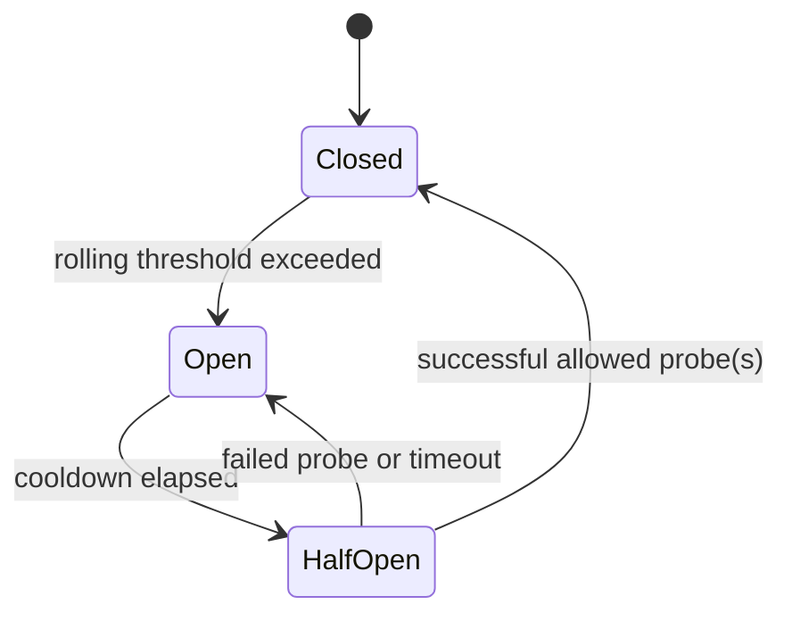

# Resilience algorithms and safety contracts

**These numeric defaults are proposals** beyond source; publish their active values in UI, make them configurable within safe bounds and assert with tests. Do not implement future policies in Phase 01.

## 0. Common failure taxonomy

`success | timeout | abort | network-error | http-429 | http-5xx | http-other | invalid-payload | rejected-by-policy | stale-fallback`. Aborts due to navigation/user cancellation are **not service failures** for breaker thresholds. Business 4xx (except selected retryable statuses) are not retryable. An HTTP 200 with schema-invalid body is a validation failure, not success. Record `outcome` separately from `statusCode`.

## 1. Timeout budget (Phase 02)

- One absolute operation deadline `deadline = clock.now() + budgetMs`; every attempt, backoff and queue wait consumes that **shared** budget.
- `remainingMs = max(0, deadline - now())`; no attempt starts without remaining time.
- Compose caller AbortSignal and per-operation deadline cleanly. On cancellation/timeout stop pending waits and abort fetch; ensure no stale response commits. If server side-effect has started, abort is **not** proof the effect did not occur.
- Recommended demo budget: 1,500ms; configurable 100–10,000ms; use documented bounds.

## 2. Retry, exponential backoff and full jitter (Phase 02)

- Eligible: safe reads, documented safe mutations with *implemented* deduplication; selected transient failures only. Unsafe mutation is ineligible by default.
- Recommended `maxAttempts = 3` including the first attempt, `baseDelayMs = 200`, `capMs = 2,000`.
- Exponential capped delay: `cap = min(capMs, baseDelayMs * 2^(retryIndex))`; **full jitter** `delay = random.next() * cap`; inject PRNG.
- Respect a valid bounded `Retry-After` on 429/503 when configured, but do not exceed operation budget. Show delay source and unit; malformed headers are ignored safely.
- Retry stops on user abort, budget exhaustion, non-retryable error, attempts exhausted and open breaker; do not recursively spawn unlimited timers.
- Trace attempt index, classification, chosen delay, remaining budget and final logical operation outcome.
- **Storm example:** unprotected fixed synchronized retries vs seeded jitter illustrating workload trade-off, not a claim of universally improved latency.

## 3. Circuit breaker (Phase 03)

- State `closed | open | half-open`, tracked per **logical downstream resource**, not whole UI.
- Suggested rolling window: latest 10 qualifying attempts within 10,000ms, threshold >= 5 failures with min sample 5. Document *denominator* and count rejected-by-breaker separately.
- Open cooldown recommended 5,000ms. Open state rejects new attempts immediately (record policy rejection without incrementing upstream attempts).
- Half-open admits **one owned probe** at a time by default. Other entrants are rejected/queued only if policy explicitly supports it; never accidentally allow multiple probes due to promise race.
- Success closes/reset window; failed/timed-out probe reopens. Caller abort should not penalize downstream. Expose transition event with reason, old/new state, timestamp.
- Breaker should not be applied blindly to distinct endpoints/services; isolation is explicit.

## 4. Bulkhead, queue and load shedding (Phase 04)

- Semaphore per downstream resource. Proposed default `maxActive=3`, `maxQueue=5` with FIFO and deterministic tie-breaking using operation IDs.
- Invariant `0 ≤ active ≤ maxActive`; release permit **exactly once** in `finally` even on timeout/throw/abort.
- Queue wait counts against timeout budget. Cancellation removes queued entry atomically; no ghost slot/promise.
- Once queue full or deadline passed, reject promptly with explicit `shed/queue-full` outcome; do not convert silently into synthetic success.
- Show queue depth, active count, rejected count, admission latency and idle recovery.

## 5. Token-bucket rate limiter (Phase 04)

- `capacity=5`, `refillRate=2 tokens/sec` suggested UI defaults. Refill based on injected elapsed monotonic time: `tokens = min(capacity, tokens + deltaMs * ratePerMs)`.
- Consume one token per admitted attempt. Define whether limiter is per user/client/resource; lab default per resource per run.
- When empty, choose explicit queued-with-deadline or rejected path; initial demo prefers immediate rejection to reveal shedding. Never invent successful upstream response.
- Rate limit reduces load; it does not directly repair failed responses. Expose starvation/trade-offs.

## 6. Stale fallback, SWR and degraded UX (Phase 05)

- Only allow stale read payloads with explicit age, origin, schema version and expiry. Example: `freshTtl=5s`, `maxStale=60s`.
- SWR returns labeled stale data while one bounded background revalidation is in progress. Background requests obey cancellation and policy limits.
- Mutation actions must not be silently executed against stale assumptions. Read-only fallback disables/guards unsafe buttons and explains why.
- When a fresh response succeeds, atomically replace stale value if it belongs to the current run/version. Late results after reset must not resurrect old state.
- UI distinguishes `fresh | stale | degraded | unavailable`, last-updated time and data source.

## 7. Hedged GET (advanced, optional after core Phase 05 or hardening)

- Never for mutation or non-idempotent operation. If ever enabled, issue a secondary **GET-only** attempt after a measured threshold, use distinct attempt IDs, cancel loser when winner wins, record **extra upstream cost**.
- Demonstrate hedging can increase upstream load and worsen overload. No marketing claim that it is always faster.

## 8. Policy composition and learning claims

Define and test order explicitly (e.g., validate operation/eligibility → shared timeout budget → breaker admission → rate limiter → bulkhead → transport attempts → policy telemetry → fallback read). Retry scope may re-enter admission policies **per physical attempt**, not wrap them invisibly. Capture a composition diagram and tests for cancellation propagation and permit release. If swapping order changes semantics, document via ADR and diagram.

## 9. Required negative tests

- Unsafe mutation attempts remain exactly 1 under transient network failure without enforced idempotency.
- Abort during backoff starts no new transport attempt.
- Breaker OPEN makes zero upstream calls on rejected logical operation.
- Half-open concurrent callers result in exactly one active probe.
- Timed-out queued request never consumes permit later.
- Malformed payload never becomes green success.
- Stale fallback displays visible age/warning and does not enable forbidden mutation.
- Reset during pending response cannot overwrite new run.
